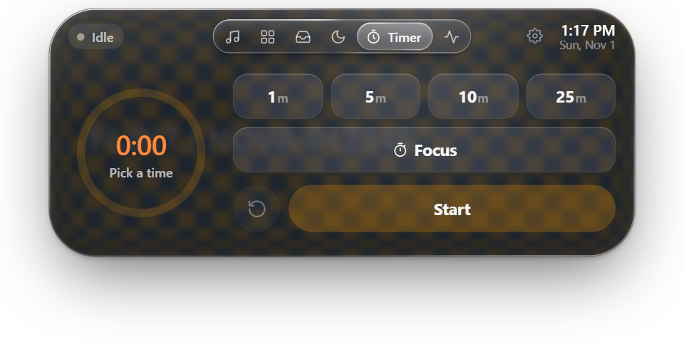
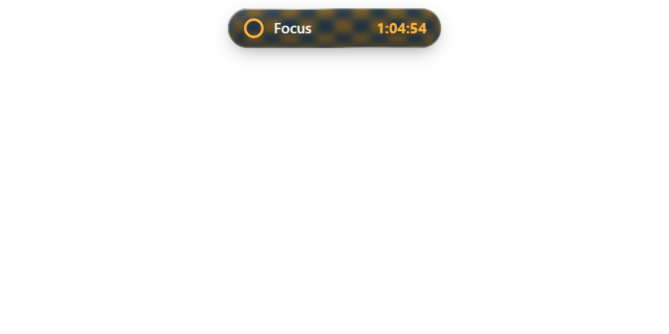
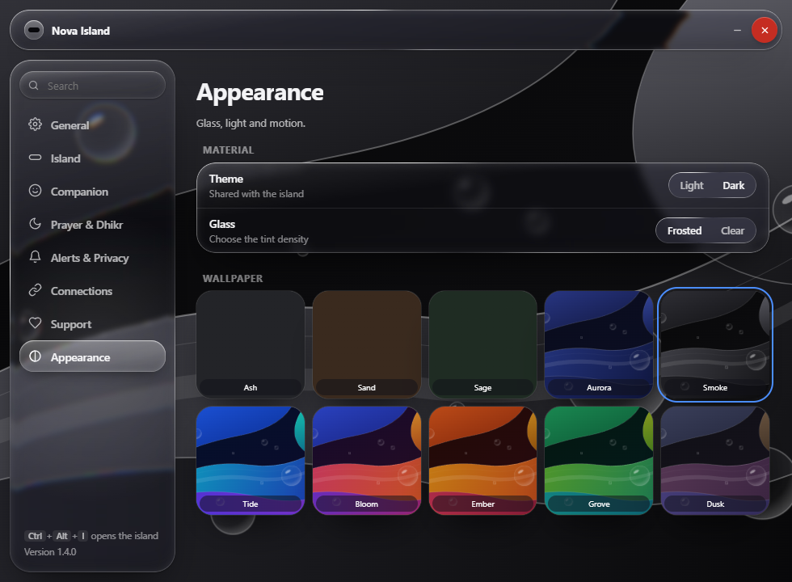
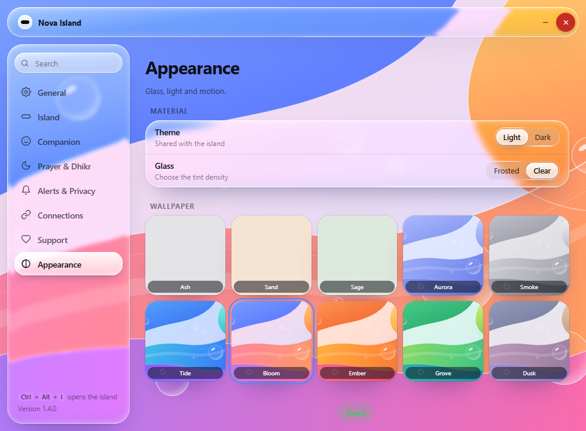

# Liquid Glass and motion review

Draft contribution for Nova Island 1.4.0, based on upstream `7e3c4ee3f1898609d02c96eee6295448304424dc`.

## Changes

- Glass shell and tab lens with bounded displacement-map caches; text and icons remain outside the optical filter.
- Shared GSAP choreography for shell, tab selection, content entrances and settings navigation. Both orientations expand from the center; side collapse keeps its edge and center fixed.
- Focus/timer capsules remain oval for 1.25 seconds, then dock over 0.9 seconds. Attached capsules flatten their top corners.
- Windows capture exclusion is checked against the actual OS flag. A small Node-API helper handles transparent-window compatibility and passive outside-click detection.
- Light/dark, clear/frosted and ten wallpaper choices synchronize between settings and island. Smoke is the default for new profiles.
- Settings map generation runs in a shared worker. Navigation animates only registered targets and uses matching CSS frost during movement, restoring full refraction afterward.

## Screenshots

These are browser fixtures with synthetic content/backdrops, not captures of a user's desktop.






## Try an isolated Windows preview

The helper binary included here is Windows x64. To rebuild it, install Visual Studio C++ Build Tools and run:

```powershell
cmd /c helper\build-glass.cmd
```

If Nova Island is already installed, reuse its Electron runtime and dependencies:

```powershell
node scripts/create-local-preview.cjs "$env:LOCALAPPDATA\Programs\Nova Island" "..\nova-glass-review"
& "..\nova-glass-review\Nova Island.exe" --settings
```

Choose a new output directory. The preview uses a separate profile and disables startup migration and auto-updates. It does not replace the installation. The normal `npm ci` / `npm start` flow uses Nova's normal profile.

## Validation

```powershell
npm test
npm install --no-save --package-lock=false playwright@1.64.1
npx playwright install chromium
npm run test:browser
```

`PLAYWRIGHT_EXECUTABLE_PATH` can select an existing Chromium executable. Browser screenshots and metrics go to ignored `.test-artifacts/` by default; set `GLASS_EVIDENCE` to use another directory.

The browser suite uses production HTML/CSS/scripts with mocked Electron bridges. It checks tab switching, clipping, horizontal and side anchors, orientation content, active filters, timer readability, outside dismissal, theme/wallpaper persistence callbacks, settings search and a 760×560 layout. Main-process tests check presentation timing and reject non-finite native move coordinates. Numeric tests cover clipped mixed-DPI capture and displacement geometry. Optional reference-byte parity is skipped unless `FLINT_REFERENCE` points to an available reference source.

The post-integration run against 1.4.0 passed without renderer errors. Settings frame p75 was 16.7 ms, p95 33.4 ms; maximum click handler 44 ms, two long tasks (maximum 185 ms). This is a local headless workload, not a native performance guarantee or a comparison benchmark. Full recorded results are in [validation.json](docs/liquid-glass/validation.json).

An earlier native Windows 10 x64 preview verified `WDA_EXCLUDEFROMCAPTURE` and the packaged settings worker. Desktop capture remained free from self-feedback during observation. The newly integrated 1.4.0 version has browser coverage; a clean installer build and full native regression remain to be completed.

## Items for maintainer review

- Windows 11, multi-monitor hardware, ARM64 and capture compatibility still need native testing. Captured glass stays disabled on Windows when native exclusion cannot be verified.
- The native helper changes window composition flags and installs a passive mouse hook. Its C source and rebuild script are included for review.
- A local Electron log previously showed a transient non-finite docking coordinate. The native move is now guarded and invalid rectangle IPC is rejected; the coordinate's original trigger still needs native investigation.
- Dependency and reference-derived asset licensing needs review before release; existing bundled library notices are retained. This contribution does not establish redistribution permissions for reference assets.
- This remains a review draft, with no installer or release published.
